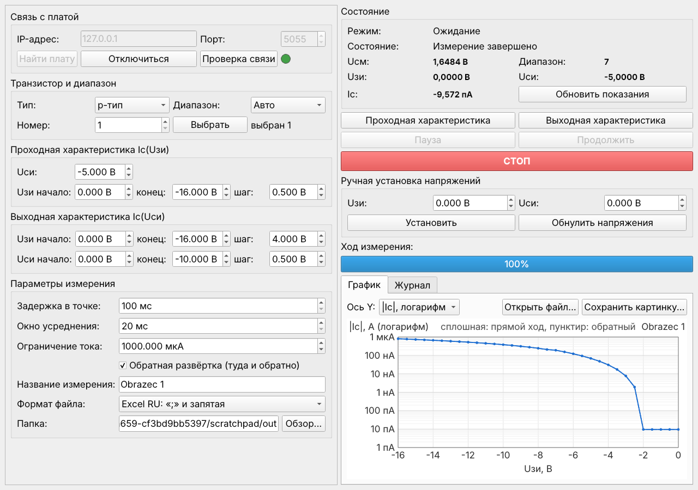
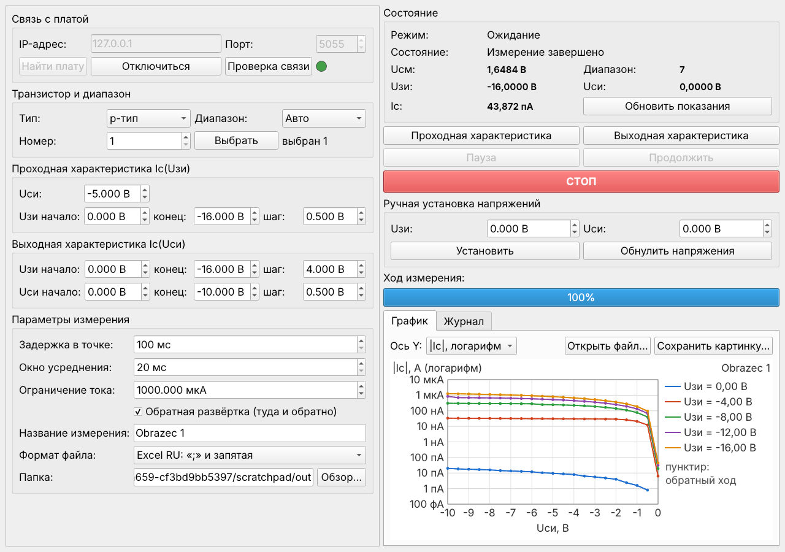

# Программа «Измерение ВАХ OFET»: как она устроена

Документ описывает программу для ПК из папки `pc_app`: из каких файлов она состоит, как построено окно, что делает каждая кнопка и каждое поле, какие классы Qt для этого использованы и как это менять самому. Протокол обмена с платой подробно описан в `CLAUDE.md` (раздел 5), здесь он упоминается только там, где нужен для понимания.

Содержание:

1. [Как пользоваться (коротко)](#1-как-пользоваться-коротко)
2. [Из каких файлов состоит программа](#2-из-каких-файлов-состоит-программа)
3. [Основы Qt, без которых код не понять](#3-основы-qt-без-которых-код-не-понять)
4. [Окно программы: все элементы](#4-окно-программы-все-элементы)
5. [Как сделана каждая часть](#5-как-сделана-каждая-часть)
6. [Файлы с результатами и графики в Excel](#6-файлы-с-результатами-и-графики-в-excel)
7. [Portable-версия (.exe для флешки)](#7-portable-версия-exe-для-флешки)
8. [Как вносить изменения: готовые рецепты](#8-как-вносить-изменения-готовые-рецепты)
9. [Эмулятор платы](#9-эмулятор-платы)

---

## 1. Как пользоваться (коротко)

1. Подключиться к плате: при запуске программа сама ищет плату и подставляет её адрес; если не нашла, нажать «Найти плату» или вписать IP вручную. Затем «Подключиться». Кружок справа станет зелёным.
2. Выбрать тип (p или n) и номер транзистора, нажать «Выбрать». Справа появится «выбран N».
3. Заполнить параметры развёртки, название измерения, папку и формат файла.
4. Нажать «Проходная характеристика» или «Выходная характеристика». Точки появляются на графике и сразу записываются в файл.
5. «Пауза» и «Продолжить» приостанавливают измерение, «СТОП» прерывает его. «Обнулить напряжения» ставит Uзи = Uси = 0.
6. Кнопка «Открыть файл...» на вкладке «График» строит график по сохранённому раньше файлу. «Сохранить картинку...» сохраняет график в PNG.

---

## 2. Из каких файлов состоит программа

| Файл | Что в нём | Класс |
|---|---|---|
| `CMakeLists.txt` | описание сборки для CMake: какие файлы компилировать, какие модули Qt подключать, создание portable-папки | |
| `cmake/deploy.cmake` | сборка portable-папки (копирует .exe и библиотеки) | |
| `src/main.cpp` | точка входа: создаёт приложение и окно, задаёт место хранения настроек | |
| `src/mainwindow.ui` | **внешний вид окна** в формате Qt Designer (XML). Правится мышкой | |
| `src/mainwindow.h`, `src/mainwindow.cpp` | логика окна: реакция на кнопки, разбор ответов платы, режимы, настройки | `MainWindow` |
| `src/deviceclient.h`, `.cpp` | связь с платой по TCP: отправка строк, приём, таймаут, автоматический PING | `DeviceClient` |
| `src/sweepparams.h`, `.cpp` | параметры развёртки, проверка ввода, формирование команд TRANS и OUTP | `SweepParams` |
| `src/measurementfile.h`, `.cpp` | запись CSV-файлов, выбор формата чисел | `MeasurementFile`, `CsvFormat` |
| `src/plotwidget.h`, `.cpp` | график (рисуется вручную) | `PlotWidget` |
| `emulator/ofet_emulator.py` | эмулятор платы для проверки без железа | |

Как части связаны между собой:

```
          кнопки, поля (mainwindow.ui)
                     |
                     v
   +------------- MainWindow -------------+
   |   |              |             |      |
   v   v              v             v      v
SweepParams    DeviceClient   MeasurementFile  PlotWidget
(проверка,     (TCP: строки   (CSV-файлы)      (график)
 команды)       к плате и от неё)
                     |
                     v
            плата STM32 или эмулятор
```

---

## 3. Основы Qt, без которых код не понять

### 3.1 Приложение и цикл событий

`main.cpp`:

```cpp
QApplication app(argc, argv);   // объект приложения, один на программу
MainWindow w;                   // главное окно
w.show();                       // показать окно
return app.exec();              // цикл событий: ждать нажатий, данных из сети, таймеров
```

Программа почти всё время находится внутри `app.exec()`. Когда что-то происходит (нажата кнопка, пришли данные по сети, сработал таймер), Qt вызывает нужную функцию. Поэтому в коде нет бесконечных циклов и ожиданий: всё построено на реакции на события.

### 3.2 Сигналы и слоты

Это главный механизм Qt. Объект **испускает сигнал** (например, кнопка испускает `clicked` при нажатии), а к сигналу **подключена функция** (слот), которая его обрабатывает. Подключение делается функцией `connect`:

```cpp
connect(m_btnSel, &QPushButton::clicked, this, &MainWindow::onSelect);
//      кто       какой сигнал            кому  какая функция вызовется
```

Все подключения кнопок собраны в одном месте: в конце функции `MainWindow::buildUi()` (`mainwindow.cpp`, блок «Сигналы»). Если хотите узнать, что делает кнопка, найдите её там.

Можно подключать и короткую безымянную функцию (лямбду), если действие в одну строку:

```cpp
connect(m_btnStop, &QPushButton::clicked, this, [this] { m_dev.send("STOP"); });
```

Свои сигналы тоже можно объявлять. Например, `DeviceClient` испускает сигнал `lineReceived` на каждую строку от платы, а `MainWindow` подключает к нему свою функцию `onLine`.

### 3.3 Q_OBJECT и moc

Класс, у которого есть сигналы или слоты, начинается со строки `Q_OBJECT` (см. `mainwindow.h`). Перед компиляцией утилита Qt **moc** читает такие заголовки и генерирует служебный код для сигналов. CMake делает это автоматически (`set(CMAKE_AUTOMOC ON)` в `CMakeLists.txt`). Именно moc выдавал ошибку, когда проект лежал в папке с русскими буквами.

### 3.4 Файл .ui и uic

Внешний вид окна хранится в `mainwindow.ui`. Это XML-файл, который удобно править в **Qt Designer** (встроен в Qt Creator, открывается двойным щелчком по `.ui`). При сборке утилита **uic** превращает его в C++-код (`ui_mainwindow.h`), это включено строкой `set(CMAKE_AUTOUIC ON)`.

В коде окно создаётся одной строкой в `buildUi()`:

```cpp
ui->setupUi(this);    // создать все кнопки, поля и компоновки из mainwindow.ui
```

После этого к любому элементу можно обратиться по его имени (свойство **objectName** в Designer): `ui->stopButton`, `ui->ipEdit` и т. д. Для краткости в `buildUi()` эти указатели переписываются в поля класса: `m_btnStop = ui->stopButton;`.

### 3.5 Компоновки (layouts)

Элементы не стоят в фиксированных координатах, а размещены в **компоновках**: они сами раскладывают элементы и растягивают их вместе с окном.

| Компоновка | Как раскладывает | Где использована |
|---|---|---|
| `QHBoxLayout` | в строку слева направо | всё окно: левая колонка и правая колонка; поле папки и кнопка «Обзор» |
| `QVBoxLayout` | в столбец сверху вниз | содержимое левой и правой колонок |
| `QGridLayout` | таблицей (строка, столбец) | группы «Связь», «Транзистор», «Проходная», «Выходная», «Состояние», кнопки управления |
| `QFormLayout` | две колонки «подпись: поле» | группа «Параметры измерения» |

Дополнительно использованы:
- `QGroupBox`: рамка с заголовком («Связь с платой», «Состояние» и т. д.);
- `QScrollArea`: левая колонка прокручивается, если окно маленькое;
- `QTabWidget`: вкладки «График» и «Журнал»;
- `Spacer` (распорка): пустое растягивающееся место, прижимает элементы.

### 3.6 Основные виды элементов

| Класс Qt | Что это | Главные свойства и функции |
|---|---|---|
| `QPushButton` | кнопка | `text`, `setEnabled()`, сигнал `clicked` |
| `QLabel` | надпись | `setText()`, `setStyleSheet()` |
| `QLineEdit` | строка текста | `text()`, `setText()`, `placeholderText` (серая подсказка) |
| `QSpinBox` | целое число со стрелками | `minimum`, `maximum`, `singleStep`, `suffix`, `value()` |
| `QDoubleSpinBox` | дробное число со стрелками | то же плюс `decimals` (знаков после запятой) |
| `QComboBox` | выпадающий список | `currentIndex()`, сигналы `activated`, `currentIndexChanged` |
| `QCheckBox` | флажок | `isChecked()` |
| `QProgressBar` | полоса хода | `setRange(min, max)`, `setValue()` |
| `QPlainTextEdit` | многострочный текст (журнал) | `appendPlainText()`, `maximumBlockCount` |
| `QMessageBox` | окно сообщения или вопроса | `warning()`, `information()`, `question()` |
| `QFileDialog` | окно выбора файла или папки | `getExistingDirectory()`, `getOpenFileName()`, `getSaveFileName()` |
| `QTimer` | таймер | `start()`, `singleShot()`, сигнал `timeout` |
| `QTcpSocket`, `QUdpSocket` | сеть | см. раздел 5.4 |
| `QSettings` | сохранение настроек | `value()`, `setValue()` |

---

## 4. Окно программы: все элементы





Окно делится на две колонки. В таблицах: имя элемента (objectName, по нему код находит элемент), класс Qt и что происходит при работе с ним. Функции указаны из `mainwindow.cpp`.

### 4.1 Группа «Связь с платой»

| Элемент | objectName | Класс | Что делает | Код |
|---|---|---|---|---|
| IP-адрес | `ipEdit` | QLineEdit | адрес платы, например `192.168.1.10` или `127.0.0.1` для эмулятора | читается в `onConnectClicked()` |
| Порт | `portSpin` | QSpinBox | TCP-порт платы, 5000 | там же |
| «Найти плату» | `findButton` | QPushButton | широковещательный поиск платы в сети, подставляет найденный адрес | `onFindBoard()`, `onDiscoverReply()`, `onDiscoverFinished()` |
| «Подключиться» / «Отключиться» | `connectButton` | QPushButton | подключение по TCP; надпись меняется в `updateUi()` | `onConnectClicked()` |
| «Сеть платы...» | `netButton` | QPushButton | окно сетевых настроек платы: «Авто» или постоянный IP (команды `NET?`, `NETSET`) | `onNetButton()`, `showNetDialog()` |
| «Проверка связи» | `pingButton` | QPushButton | шлёт `PING`, плата отвечает `PONG` | лямбда в `buildUi()` |
| Кружок-индикатор | `linkLed` | QLabel | цвет связи: серый (нет), жёлтый (подключение, поиск), зелёный (есть), красный (ошибка, нет ответа) | `setLed()` |

### 4.2 Группа «Транзистор и диапазон»

| Элемент | objectName | Класс | Что делает | Код |
|---|---|---|---|---|
| Тип | `typeCombo` | QComboBox | p-тип (индекс 0) или n-тип (индекс 1), передаётся в команде измерения и пишется в файл | `collectParams()` |
| Номер | `transistorSpin` | QSpinBox | номер транзистора 1...5 | `onSelect()` |
| «Выбрать» | `selectButton` | QPushButton | шлёт `SEL;n`, плата переключает реле | `onSelect()` |
| «выбран N» | `selectedLabel` | QLabel | какой транзистор подтвердила плата (по ответу `ACK;SEL`) | `onLine()` |
| Диапазон | `rangeCombo` | QComboBox | «Авто» (индекс 0) или диапазон 1...7. При выборе сразу шлёт `RANGE;n`, а также перед каждым измерением | `onRangeChanged()`, `startSweep()` |

### 4.3 Группы «Проходная характеристика» и «Выходная характеристика»

Все поля: `QDoubleSpinBox` с пределами от -18 до +15 В (для шага от 0,001 до 33 В), суффиксом « В» и тремя знаками после запятой. Пределы заданы в `.ui` (свойства `minimum`, `maximum`).

| Элемент | objectName |
|---|---|
| Проходная: Uси | `tUdsSpin` |
| Проходная: Uзи начало, конец, шаг | `tUgsStartSpin`, `tUgsStopSpin`, `tUgsStepSpin` |
| Выходная: Uзи начало, конец, шаг (семейство кривых) | `oUgsStartSpin`, `oUgsStopSpin`, `oUgsStepSpin` |
| Выходная: Uси начало, конец, шаг (развёртка) | `oUdsStartSpin`, `oUdsStopSpin`, `oUdsStepSpin` |

Значения собираются в структуру `SweepParams` функцией `collectParams()`.

### 4.4 Группа «Параметры измерения»

| Элемент | objectName | Класс | Что делает |
|---|---|---|---|
| Задержка в точке | `delaySpin` | QSpinBox | 100...60000 мс, пауза после установки напряжения до измерения |
| Окно усреднения | `windowSpin` | QSpinBox | 20...2000 мс, шаг 20 (кратно периоду сети 50 Гц) |
| Ограничение тока | `ilimSpin` | QDoubleSpinBox | в микроамперах; при превышении плата снимает напряжения |
| Обратная развёртка | `reverseCheck` | QCheckBox | пройти туда и обратно (см. ниже) |
| Название измерения | `nameEdit` | QLineEdit | попадает в имя файла; серая подсказка задана свойством `placeholderText` |
| Формат файла | `csvFormatCombo` | QComboBox | разделитель столбцов и десятичный знак в CSV (раздел 6) |
| Папка | `folderEdit` | QLineEdit | куда сохранять файлы |
| «Обзор...» | `folderButton` | QPushButton | окно выбора папки | 

**Что значит «развёртка туда и обратно».** Без флажка напряжение проходит один раз от начала до конца, например Uзи = 0 -> -16 В. С флажком после этого оно возвращается обратно -16 -> 0 В по тем же точкам. Прямой ход в файле помечен «Проход = 1», обратный «Проход = 2», на графике обратный ход нарисован пунктиром. Зачем: у органических транзисторов ток при одном и том же напряжении часто зависит от того, с какой стороны к нему подошли (гистерезис). Причины: заряды, захваченные ловушками в полупроводнике и на границе с диэлектриком, подвижные ионы. Если кривые туда и обратно совпадают, гистерезиса нет; расхождение между ними и есть его величина. Для выходной характеристики обратный ход делается по Uси внутри каждого Uзи. Время измерения при этом вдвое больше.

### 4.5 Правая колонка

| Элемент | objectName | Класс | Что делает | Код |
|---|---|---|---|---|
| Режим | `modeLabel` | QLabel | Нет связи / Ожидание / Проходная / Выходная / Пауза | `setMode()` |
| Состояние | `stateLabel` | QLabel | последнее событие; ошибки красным жирным | `setState()` |
| Uсм, Uзи, Uси, Iс, Диапазон | `ubiasValue`, `ugsValue`, `udsValue`, `currentValue`, `rangeValue` | QLabel | показания платы | `showIndicators()`, `onLine()` |
| «Обновить показания» | `measButton` | QPushButton | шлёт `MEAS?`, плата делает одно измерение | лямбда в `buildUi()` |
| «Проходная характеристика» | `transButton` | QPushButton | запуск измерения | `onStartTransfer()` -> `startSweep()` |
| «Выходная характеристика» | `outpButton` | QPushButton | запуск измерения | `onStartOutput()` -> `startSweep()` |
| «Пауза», «Продолжить» | `pauseButton`, `resumeButton` | QPushButton | шлют `PAUSE`, `RESUME` | лямбды в `buildUi()` |
| «СТОП» | `stopButton` | QPushButton | шлёт `STOP`; красная за счёт styleSheet | лямбда в `buildUi()` |
| Ручная установка: Uзи, Uси | `setUgsSpin`, `setUdsSpin` | QDoubleSpinBox | значения для `SETV` | `onSetV()` |
| «Установить» | `setVButton` | QPushButton | шлёт `SETV;Uзи;Uси` | `onSetV()` |
| «Обнулить напряжения» | `zeroButton` | QPushButton | шлёт `ZERO` | `onZero()` |
| Полоса хода | `progressBar` | QProgressBar | сколько точек из скольких измерено | `startSweep()`, `onLine()` |
| Вкладки | `viewTabs` | QTabWidget | «График» и «Журнал» | |
| Ось Y | `yModeCombo` | QComboBox | Iс линейно / \|Iс\| логарифм / sqrt(\|Iс\|) | подключено к `PlotWidget::setYMode` |
| «Открыть файл...» | `openFileButton` | QPushButton | построить график по сохранённому файлу | `onOpenFile()`, `loadMeasurementFile()` |
| «Сохранить картинку...» | `savePlotButton` | QPushButton | сохранить график в PNG | `onSavePlot()` |
| График | `plotWidget` | PlotWidget (свой класс) | кривые ВАХ | `plotStart()`, `plotPoint()` |
| Журнал | `logEdit` | QPlainTextEdit | обмен с платой и события, с временем до миллисекунд | `log()` |

---

## 5. Как сделана каждая часть

### 5.1 Цвет и вид кнопок (styleSheet)

Вид элементов в Qt меняется **таблицами стилей** (styleSheet). Синтаксис похож на CSS из веб-страниц. Красная кнопка СТОП сделана так (свойство `styleSheet` кнопки `stopButton` в `.ui`):

```css
QPushButton { background: #d32f2f; color: white; font-weight: bold; }
QPushButton:disabled { background: #e0a0a0; }
```

- `background`: цвет фона, `color`: цвет текста, `font-weight: bold`: жирный шрифт.
- `:disabled`: как выглядит недоступная кнопка (бледно-красная, когда нет связи).
- Цвет пишется как `#RRGGBB` (красный, зелёный, синий в шестнадцатеричной записи) или словом: `red`, `green`, `orange`.

**Как изменить в Qt Designer:** правый щелчок по кнопке -> «Изменить styleSheet...» -> вписать текст -> OK. Кнопка «Добавить цвет» в этом окне открывает палитру.

Другие полезные свойства:

```css
QPushButton { background: #1976d2; color: white; border-radius: 6px; padding: 6px; font-size: 11pt; }
QPushButton:hover { background: #1565c0; }      /* под курсором мыши */
QPushButton:pressed { background: #0d47a1; }    /* нажата */
```

Если задать стиль у группы (`QGroupBox`) или у всего окна (`MainWindow`), он подействует на все элементы внутри. Например, у `MainWindow`: `QPushButton { min-height: 28px; }` сделает все кнопки выше.

**Из кода** стиль задаётся функцией `setStyleSheet()`. Так меняется цвет надписи состояния (красный при ошибке):

```cpp
m_lblState->setStyleSheet(error ? "color:#c62828; font-weight:bold;" : "");
```

### 5.2 Индикатор связи (цветной кружок)

Это обычная надпись `QLabel` размером 18 x 18 пикселей без текста. Круглой её делает стиль `border-radius: 9px` (скругление, равное половине размера):

```cpp
void MainWindow::setLed(const QString &color)
{
    m_led->setStyleSheet(QString("background:%1; border-radius:9px; border:1px solid #555;").arg(color));
}
```

Цвета задаются в вызовах `setLed(...)`: `#9e9e9e` серый, `#fdd835` жёлтый, `#43a047` зелёный, `#e53935` красный.

### 5.3 Режимы программы и доступность кнопок

У программы пять режимов (`enum class Mode` в `mainwindow.h`):

| Режим | Когда |
|---|---|
| `Offline` | нет связи |
| `Idle` | связь есть, измерения нет |
| `Starting` | команда запуска отправлена, ждём `ACK` |
| `Running` | идёт измерение |
| `Paused` | пауза |

Режим меняет функция `setMode()`. Она пишет название режима, ставит цвет индикатора и вызывает `updateUi()`. А `updateUi()` включает и выключает кнопки через `setEnabled(true/false)`: например, «Проходная характеристика» доступна только в `Idle`, а поля параметров недоступны во время измерения. Если добавляете новую кнопку, её доступность удобно задать там же.

### 5.4 Связь с платой: TCP, проверка связи, таймауты

Вся сеть находится в классе `DeviceClient` (`deviceclient.cpp`). Он работает с `QTcpSocket`, это TCP-соединение Qt.

- **Подключение:** `connectToDevice(host, port)` вызывает `m_sock.connectToHost(...)`. Подключение идёт в фоне. Когда оно состоится, сокет испускает сигнал `connected`, `DeviceClient` передаёт его дальше, и `MainWindow::onConnected()` переводит программу в `Idle` и запрашивает `STAT?`.
- **Отправка:** `send("PING")` пишет в сокет строку и символ перевода строки `\n`. Каждая отправка попадает в журнал через сигнал `exchange`.
- **Приём:** данные из сети приходят кусками, поэтому в `onReadyRead()` они копятся в буфере `m_rx`, и из него вырезаются целые строки до `\n`. Каждая строка разбивается по `;` и отправляется сигналом `lineReceived` в `MainWindow::onLine()`.
- **Таймаут 2 с:** после каждой отправки запускается таймер `m_watchdog` на 2000 мс. Пришла любая строка, и таймер останавливается. Не пришла, и срабатывает `onWatchdog()`, а окно показывает «Нет ответа от платы» и красный индикатор (`MainWindow::onTimeout()`). Во время измерения таймер перезапускается на каждую строку: плата шлёт что-нибудь не реже раза в 0,5 с.
- **Автоматический PING:** таймер `m_keepAlive` каждые 3 с шлёт `PING`, если программа сама ничего не отправляла. Это нужно плате: если от ПК 10 с нет ни одной строки, она считает связь потерянной и снимает напряжения. Автоматические PING и ответы на них в журнал не пишутся, чтобы его не засорять.
- **Кнопка «Проверка связи»** просто шлёт `PING`. Ответ `PONG` в `onLine()` выводит «Связь в порядке» и зелёный индикатор.

### 5.5 Подключение по Ethernet и поиск платы

Как это устроено внутри (уровни TCP/IP, байты в кабеле, как Windows и Qt сообщают о приходе данных, как то же будет сделано на плате): отдельный документ [`ETHERNET_KAK_RABOTAET.md`](ETHERNET_KAK_RABOTAET.md).

**Кто есть кто.** Плата работает как **сервер**: после включения она ждёт подключений на **TCP-порту 5000**. Программа на ПК работает как **клиент**: она сама подключается к плате. Чтобы подключиться, программе нужны два числа: **IP-адрес** платы (её адрес в сети, вида `192.168.1.10`) и **порт** (номер «двери» на плате, через которую принимаются команды). Порт не ищется: он всегда 5000, так задано в прошивке, и это же значение стоит в программе по умолчанию. Искать приходится только IP-адрес, потому что он зависит от способа подключения.

**Как плата получает IP-адрес** (это делает прошивка). У платы два режима, выбираются кнопкой «Сеть платы...»:

- **«Авто»** (по умолчанию). После включения плата около 5 с просит адрес у роутера (протокол DHCP: роутер раздаёт адреса всем устройствам своей сети) и берёт выданный, например `192.168.1.37`. Если роутера нет (кабель прямо в ПК), плата сама выбирает адрес вида `169.254.x.x` (механизм AutoIP). Ровно так же поступает и Windows с любым сетевым разъёмом, на котором нет роутера, причём на любом компьютере: диапазон `169.254.x.x` стандартный. Поэтому ПК и плата оказываются в одной сети без всякой настройки. Заранее адрес неизвестен, его находит поиск.
- **«Постоянный адрес».** Плата всегда использует заданные IP, маску и шлюз. Удобно, если плата постоянно стоит в одной сети и хочется всегда вписывать один и тот же адрес. Адрес должен быть из сети компьютера (если у ПК `192.168.1.185`, то `192.168.1.x`) и не занят другим устройством.

Порт в обоих режимах 5000.

**Вариант 1: кабель прямо из платы в ПК.** На ПК ничего настраивать не нужно. После подключения кабеля Windows ищет роутер и, не найдя, примерно через 10...60 с назначает разъёму адрес `169.254.x.x`. Плата делает то же самое. Затем в программе нажать «Найти плату» (или перезапустить программу: при запуске поиск выполняется сам) и «Подключиться». Если ПК одновременно подключён к роутеру по Wi-Fi, это не мешает: сети разные.

**Вариант 2: плата и ПК подключены к одному роутеру.** Тоже ничего не настраивать: плата получит адрес от роутера, программа найдёт её поиском.

**Окно «Сеть платы...»** (доступно при подключённой плате). Программа спрашивает у платы `NET?` и показывает текущий адрес и режим. Можно выбрать «Авто» или «Постоянный адрес» и нажать «Сохранить в плату»: программа отправляет `NETSET`, плата записывает настройки в свою память. Действуют они после перезапуска платы (выключить и включить питание или кнопка сброса). Окно строится в коде функцией `showNetDialog()`: `QDialog`, переключатели `QRadioButton`, поля `QLineEdit` с проверкой формата адреса (`QRegularExpressionValidator`), кнопки `QDialogButtonBox`.

**Защита от ошибки.** Если плате задать постоянный адрес из чужой сети, подключиться к ней с этого ПК нельзя. Но поиск её всё равно найдёт: плата отвечает на поиск широковещательно, такой ответ получают все компьютеры в кабеле независимо от адресов. Программа видит, что адрес не из сети ПК (функция `inLocalSubnet()`), и предлагает сбросить сеть платы на «Авто»: отправляет по UDP команду `NETAUTO`. После перезапуска платы она снова находится поиском.

**Как работает «Найти плату»** (функции `onFindBoard()`, `onDiscoverReply()`, `onDiscoverFinished()`):
1. Программа составляет список сетей, к которым подключён ПК (`QNetworkInterface::allInterfaces()`): для каждой сетевой карты берётся её **широковещательный адрес**. Это адрес «всем в этой сети»: для сети `192.168.0.x` он `192.168.0.255`. Добавляется общий адрес `255.255.255.255` и `127.0.0.1` (на случай эмулятора на этом же ПК).
2. На каждый из этих адресов отправляется короткое сообщение `DISCOVER` по протоколу **UDP** на порт **5001**. UDP подходит для этого лучше TCP: сообщение отправляется сразу всем, без подключения к каждому.
3. Это сообщение получают все устройства в сети, но отвечает только плата OFET: `OFET;192.168.0.37;5000`, то есть свой IP-адрес и TCP-порт.
4. Программа ждёт ответы 1,5 с. Если ответила одна плата, её адрес и порт сами подставляются в поля. Если несколько, появится список для выбора. Если никто, программа напишет, что плата не найдена. При запуске программы этот поиск выполняется автоматически (таймер `QTimer::singleShot(500, ...)` в конструкторе окна).
5. Дальше нажать «Подключиться».

Ограничения поиска: широковещательные сообщения не проходят через роутер в другие сети, поэтому плата находится только если она в той же локальной сети, что и ПК. При первом запуске Windows может спросить, разрешить ли программе доступ к сети: надо разрешить (хотя бы для частных сетей), иначе брандмауэр не пропустит ответ платы. Занятый на вашем ПК порт 5001 поиску платы не мешает: программа отправляет запрос со свободного порта, а порт 5001 должен быть свободен только на самой плате. Он мешал лишь эмулятору, который запускается на том же ПК и должен сам слушать порт 5001.

**Что происходит при нажатии «Подключиться»** (`onConnectClicked()`, класс `DeviceClient`):
1. `QTcpSocket::connectToHost(IP, 5000)` устанавливает TCP-соединение. Индикатор жёлтый.
2. Плата приняла соединение: индикатор зелёный, режим «Ожидание», программа сразу спрашивает `STAT?` и показывает Uсм, выбранный транзистор, диапазон.
3. Дальше обмен идёт строками текста: команда от ПК, ответ от платы (протокол в `CLAUDE.md`, раздел 5). Все строки видны во вкладке «Журнал».
4. Если 3 с ничего не отправлялось, программа сама шлёт `PING`, плата отвечает `PONG`. Если на любую команду нет ответа 2 с, индикатор красный, «Нет ответа от платы».
5. Если от ПК 10 с не приходит ни одной строки (программа закрыта, кабель выдернут), плата сама снимает напряжения с транзистора.
6. Если соединение оборвалось, программа пишет «Соединение закрыто», закрывает файл измерения с пометкой «прервано», режим «Нет связи». Переподключиться: снова «Подключиться».

Если подключиться не удаётся: проверить кабель (на разъёме платы должны мигать светодиоды), подождать минуту после подключения кабеля (Windows не сразу назначает адрес 169.254.x.x) и набрать в командной строке Windows `ping` и найденный адрес платы. Свой адрес ПК показывает команда `ipconfig`. Если плата отвечает на ping, но программа не подключается, значит, не запущен TCP-сервер в прошивке или неверный порт.

### 5.6 Обработка ответов платы

`MainWindow::onLine()` получает строку, уже разбитую на поля (`f[0]`, `f[1]`, ...), и смотрит на первое поле:

| Ответ | Что делает программа |
|---|---|
| `PONG` | «Связь в порядке» |
| `STAT;...` | показывает Uсм, выбранный транзистор, диапазон |
| `MEAS;...` | обновляет индикаторы |
| `ACK;SEL;n` | запоминает выбранный транзистор (`m_selected`) |
| `ACK;TRANS`, `ACK;OUTP` | открывает файл, очищает график, режим `Running` |
| `ACK;PAUSE`, `ACK;RESUME` | режим `Paused` или `Running` |
| `ERR;команда;код` | текст ошибки красным (тексты в `errText()`) |
| `DATA;...` | точка: в файл, на график, в индикаторы, в полосу хода |
| `PROG;N;всего` | полоса хода |
| `DONE` | закрыть файл, «Измерение завершено» |
| `ABORT` | закрыть файл, «Измерение прервано» |
| `OVERI` | превышение тока: сообщение и запись в файл |

### 5.7 Запуск измерения и окно предупреждения

Обе кнопки запуска вызывают `startSweep()`:

```cpp
void MainWindow::startSweep(SweepParams::Kind kind)
{
    const SweepParams p = collectParams(kind);      // 1. собрать значения из полей
    QString err = p.validate();                     // 2. проверить
    if (err.isEmpty() && !QDir(m_folder->text().trimmed()).exists())
        err = "Папка для сохранения не существует";
    if (err.isEmpty() && m_selected != p.transistor)
        err = QString("Сначала выберите транзистор %1 кнопкой «Выбрать»").arg(p.transistor);
    if (!err.isEmpty()) {
        QMessageBox::warning(this, "Проверка параметров", err);   // 3. окно предупреждения
        return;                                                   //    и ничего не отправляем
    }
    ...                                             // 4. полоса хода, режим Starting
    m_dev.send(QString("RANGE;%1").arg(p.range));   // 5. команды плате
    m_dev.send(p.toCommand());
}
```

**Окно предупреждения** создаёт одна строка `QMessageBox::warning(родитель, заголовок, текст)`. Пока окно открыто, программа ждёт нажатия OK (это называется модальное окно). Похожие функции:
- `QMessageBox::information(...)`: окно с синим значком «i»;
- `QMessageBox::critical(...)`: ошибка, красный значок;
- `QMessageBox::question(...)`: вопрос с кнопками «Да» и «Нет». Так сделан вопрос при закрытии программы во время измерения:

```cpp
const auto r = QMessageBox::question(this, "Выход", "Идёт измерение. Остановить его и выйти?");
if (r != QMessageBox::Yes) { ... }
```

**Проверка ввода** находится в `SweepParams::validate()` (`sweepparams.cpp`). Там же тексты всех сообщений: пустое название, шаг 0, начало равно концу, напряжение вне пределов, окно не кратно 20 мс и т. д. Функция возвращает пустую строку, если всё верно, иначе текст ошибки.

### 5.8 Полоса хода измерения

`QProgressBar` показывает долю `value` от диапазона `minimum...maximum` в процентах.

1. При запуске (`startSweep()`) программа сама считает ожидаемое число точек `p.totalPoints()` и ставит `m_progress->setRange(0, всего)`, `setValue(0)`.
2. На каждую точку `DATA;N;...` ставится `setValue(N)`.
3. Плата шлёт `PROG;N;всего`. Если её «всего» отличается, диапазон уточняется: `setRange(0, всего)`.
4. По `DONE` полоса доводится до 100 %.

Цвет полосы тоже меняется стилем, например у `progressBar`:
`QProgressBar::chunk { background: #43a047; }`.

### 5.9 Выбор папки для сохранения

Кнопка «Обзор...» вызывает `onBrowseFolder()`:

```cpp
const QString d = QFileDialog::getExistingDirectory(this, "Папка для сохранения", m_folder->text());
if (!d.isEmpty()) {                                   // пустая строка = нажали «Отмена»
    m_folder->setText(QDir::toNativeSeparators(d));   // показать путь с обратными косыми, как в Windows
    openLogFile();                                    // журнал обмена теперь пишется в эту папку
}
```

`QFileDialog` показывает стандартное окно Windows. Для файлов есть `getOpenFileName()` (кнопка «Открыть файл...») и `getSaveFileName()` («Сохранить картинку...»).

### 5.10 Сохранение результатов в файл

За это отвечает класс `MeasurementFile` (`measurementfile.cpp`):

- **Когда открывается файл:** по ответу платы `ACK;TRANS` или `ACK;OUTP` (то есть только если плата приняла команду). Функция `open()` создаёт файл через `QFile`, пишет метку BOM (по ней Excel понимает, что текст в UTF-8, и показывает русские буквы) и строку заголовков.
- **Имя файла:** `<Название>_<ГГГГММДД>_<ччммсс>_T<n>_<PROH|VYH>.csv`. Недопустимые в имени символы и пробелы заменяются на `_`. Время берётся из `QDateTime::currentDateTime()`.
- **Запись точек:** `addPoint()` на каждую строку `DATA` добавляет строку в файл и сразу вызывает `flush()`, то есть сбрасывает её на диск. Если программа или ПК аварийно выключатся, уже измеренные точки не пропадут.
- **Закрытие:** `close()` по `DONE`, `ABORT`, отключению. Дописывает строку «Итог» (завершено или прервано). Для выходной характеристики дополнительно пишется файл `_wide` (раздел 6).
- **Формат чисел** задаёт структура `CsvFormat` (раздел 6.2).

### 5.11 Журнал

Функция `log(текст)` добавляет строку с временем `ЧЧ:ММ:СС.ммм` в окно журнала (`appendPlainText`) и в файл `obmen_<ГГГГММДД>.log` в папке сохранения. Окно журнала хранит не более 5000 строк (`maximumBlockCount`), чтобы не тормозить. Строки со знаком `>` отправлены плате, со знаком `<` получены от неё.

### 5.12 Сохранение настроек

При закрытии программы и перед каждым измерением `saveSettings()` записывает все поля (IP, порт, папку, параметры, формат файла, размер окна) через `QSettings`. При запуске `loadSettings()` их восстанавливает. В `main.cpp` указано хранить настройки в файле `OFET/OfetMeter.ini` **рядом с программой**, поэтому при переносе папки на флешке настройки переезжают вместе с ней. Если в папку программы писать нельзя, используется реестр Windows.

Пример:

```cpp
QSettings s;
s.setValue("link/ip", m_ip->text());                    // записать
m_ip->setText(s.value("link/ip", "192.168.1.10").toString());   // прочитать (второе значение - по умолчанию)
```

### 5.13 График (класс PlotWidget)

Готовый модуль графиков Qt Charts ставится не со всеми установками Qt, поэтому график нарисован вручную: `PlotWidget` наследует `QWidget` и переопределяет функцию `paintEvent()`, которую Qt вызывает каждый раз, когда виджет надо перерисовать. Внутри используется `QPainter`: `drawLine` (оси, сетка), `drawText` (подписи), `drawPath` (кривые), `drawEllipse` (точки).

- `addPoint(группа, пунктир, подпись, x, ток)` добавляет точку и вызывает `update()`, это просьба к Qt перерисовать график.
- Группа задаёт цвет кривой: для выходной характеристики это номер Uзи в семействе. Обратный ход рисуется пунктиром того же цвета.
- Ось Y: `setYMode()` переключает между током, логарифмом модуля тока и корнем из модуля тока. Для логарифма сетка рисуется по декадам (1 нА, 10 нА, 100 нА...).
- Подписи осей с приставками (пА, нА, мкА) делает функция `formatSi()`.
- Под курсором мыши показываются координаты точки (`mouseMoveEvent`).
- Картинка: `savePng()` рисует график в `QPixmap` с удвоенным разрешением и сохраняет в PNG.

**Как свой виджет попал в Qt Designer:** в `.ui` на месте графика стоит обычный `QWidget`, «повышенный» (promoted) до класса `PlotWidget` с заголовком `plotwidget.h`. В Designer он выглядит как пустой прямоугольник, его можно перемещать и менять размеры, а при сборке на его месте создаётся настоящий график. Так же можно добавить любой свой виджет: правый щелчок по `QWidget` -> «Преобразовать в...» (Promote to...).

Связь окна с графиком (`mainwindow.cpp`):
- `plotStart()` при `ACK;TRANS/OUTP`: очистить график, подписать ось X (Uзи или Uси), переключиться на вкладку «График»;
- `plotPoint()` на каждую точку `DATA`;
- `loadMeasurementFile()` читает сохранённый CSV в любом из форматов и строит по нему график.

---

## 6. Файлы с результатами и графики в Excel

### 6.1 Что в столбцах

Основной файл (`..._PROH.csv` или `..._VYH.csv`). Первая строка содержит заголовки, со второй идут точки:

| Столбец | Заголовок | Что это |
|---|---|---|
| A | N | номер точки по порядку |
| B | Проход | 1 = прямой ход, 2 = обратный (если включена обратная развёртка) |
| C | Uзи, В | напряжение затвор-исток |
| D | Uси, В | напряжение сток-исток |
| E | Iс, А | ток стока со знаком (у p-типа отрицательный) |
| F | \|Iс\|, А | модуль тока, для графика в логарифмическом масштабе |
| G | sqrt(\|Iс\|), А^0,5 | корень из модуля тока, для определения порогового напряжения по проходной характеристике |
| H | Диапазон | диапазон ТИА 1...7, на котором измерена точка |
| I | Флаги | 0 = норма; 1 = перегрузка усилителя (точка недостоверна); 2 = ток у предела чувствительности |
| J | | пустой столбец-разделитель |
| K, L | Параметр, Значение | параметры измерения: название, дата, тип, транзистор, напряжения, задержка, окно, ограничение тока, Uсм, итог |

Ток записан в экспоненциальном виде: `-2,4492E-07` означает -2,4492 · 10^-7 А = -244,92 нА. Excel понимает такую запись как число.

Файл `..._VYH_wide.csv` (только для выходной характеристики) удобен для семейства кривых: первый столбец Uси, дальше по столбцу тока на каждое Uзи («Iс, А при Uзи = -4,00 В»), для обратного хода отдельные столбцы с пометкой «(обратно)».

### 6.2 Формат чисел (поле «Формат файла»)

Excel открывает CSV по правилам из «Региональных стандартов» Windows: разделитель столбцов и десятичный знак берутся оттуда. Если они не совпадают с файлом, все данные оказываются в одном столбце через `;`. Поэтому в программе есть выбор:

| Вариант | Столбцы | Десятичный знак | Когда выбирать |
|---|---|---|---|
| Авто (как в Windows) | как в Windows | как в Windows | **по умолчанию**: программа читает настройки этого ПК, и Excel на нём откроет файл правильно |
| Excel RU | `;` | запятая | Windows с русскими региональными настройками |
| Столбцы «,» и точка | `,` | точка | английские региональные настройки, Python, MATLAB |
| Табуляция и точка (.txt) | табуляция | точка | Origin, SciDAVis, вставка в любую программу |

Какой формат использован, видно в журнале при начале записи: «столбцы: «;», десятичный знак: «,»».

Если файл всё-таки открылся в один столбец (например, на другом ПК), в Excel: выделить столбец A -> вкладка «Данные» -> «Текст по столбцам» -> «с разделителями» -> отметить нужный разделитель -> «Подробнее» -> указать десятичный разделитель -> «Готово».

### 6.3 Как построить график в Excel

Проходная характеристика в логарифмическом масштабе:
1. Выделить столбец C (Uзи), затем с нажатой Ctrl столбец F (|Iс|).
2. «Вставка» -> «Точечная» -> «Точечная с прямыми отрезками и маркерами».
3. Правый щелчок по вертикальной оси -> «Формат оси» -> «Логарифмическая шкала».

Для порогового напряжения взять столбцы C и G (sqrt(|Iс|)) в линейном масштабе.

Семейство выходных характеристик: открыть файл `_wide`, выделить всю таблицу, вставить точечную диаграмму. Каждый столбец тока станет отдельной кривой.

---

## 7. Portable-версия (.exe для флешки)

Программе для запуска нужны библиотеки Qt (`Qt5Core.dll`, `Qt5Gui.dll`, `Qt5Widgets.dll`, `Qt5Network.dll`), плагин `platforms/qwindows.dll` и библиотеки компилятора MinGW (`libgcc_s_seh-1.dll`, `libstdc++-6.dll`, `libwinpthread-1.dll`). Когда программа запускается из Qt Creator, он сам подсказывает ей, где эти файлы лежат. При двойном щелчке по `.exe` в папке сборки (`build-...-Release`) их взять неоткуда, поэтому Windows пишет «не найден Qt5Core.dll». Это нормально: для запуска без Qt Creator используется отдельная папка.

1. В Qt Creator слева внизу нажать на значок компьютера над зелёным треугольником и выбрать сборку **Release** (не Debug).
2. Собрать проект (молоток или Ctrl+B).
3. Рядом с папкой `pc_app` появится папка **`OfetMeter_portable`**: `OfetMeter.exe`, библиотеки, папки `platforms` и `styles`, файл `deploy_log.txt` (отчёт о том, что скопировано).
4. Эту папку целиком скопировать на флешку или другой ПК и запускать `OfetMeter.exe`. Устанавливать Qt там не нужно.

Как это сделано: в конце `CMakeLists.txt` команда `add_custom_command(TARGET OfetMeter POST_BUILD ...)` после каждой сборки запускает скрипт `cmake/deploy.cmake`. Скрипт работает только для Release: в Debug нужны отладочные библиотеки Qt, они в несколько раз больше и медленнее. Скрипт копирует `.exe` и перечисленные файлы прямо из папки Qt (`C:\Qt\5.15.2\mingw81_64\bin` и `plugins`), а затем, если найдёт, запускает утилиту Qt `windeployqt`, которая может доложить ещё что-нибудь. Папка `OfetMeter_portable` не попадает в git (указана в `.gitignore`).

**Если программа из папки всё равно не запускается:**
1. Открыть `OfetMeter_portable\deploy_log.txt`: строки «НЕ НАЙДЕН» покажут, какого файла не хватило.
2. Запасной ручной способ: меню «Пуск» -> папка «Qt» -> «Qt 5.15.2 (MinGW 8.1.0 64-bit)» (открывается командная строка с настроенными путями Qt) и выполнить
   ```
   windeployqt C:\OFET\OfetMeter_portable\OfetMeter.exe
   ```
   Утилита скопирует все нужные библиотеки к программе.

Копировать только сам `.exe` без остальных файлов нельзя.

---

## 8. Как вносить изменения: готовые рецепты

**Изменить надпись, цвет, размер, расположение.** Только в Qt Designer (`mainwindow.ui`), код трогать не нужно. Не менять у существующих элементов `objectName`: по ним код находит элементы, и сборка остановится с ошибкой вида `'class Ui::MainWindow' has no member named ...`.

**Изменить пределы поля** (например, разрешить Uзи до +20 В). В Designer выделить поле -> «Редактор свойств» -> `maximum`. Пределы проверяются ещё и в коде: константы `kUserUMin`, `kUserUMax` в `sweepparams.h`. И прошивка платы проверяет их сама.

**Добавить новую кнопку с действием:**
1. В Designer перетащить `Push Button` из панели слева в нужное место компоновки, задать `text` и `objectName`, например `myButton`.
2. В `mainwindow.h` в раздел `private slots:` добавить `void onMyButton();`.
3. В `mainwindow.cpp` в конец `buildUi()` добавить
   `connect(ui->myButton, &QPushButton::clicked, this, &MainWindow::onMyButton);`
4. Там же написать функцию:
   ```cpp
   void MainWindow::onMyButton()
   {
       log("Нажата моя кнопка");
       m_dev.send("PING");
   }
   ```
5. Если кнопка должна быть доступна не всегда, добавить строку в `updateUi()`, например `ui->myButton->setEnabled(idle);`.

**Показать своё сообщение пользователю:**
```cpp
QMessageBox::information(this, "Заголовок", "Текст сообщения");
```

**Добавить столбец в CSV:** в `MeasurementFile::open()` добавить заголовок в список, в `addPoint()` добавить значение в список `row` на то же место.

**Изменить цвета кривых графика:** массив `pal[]` в функции `PlotWidget::color()` (`plotwidget.cpp`).

После любых изменений: сохранить (Ctrl+S) и запустить (Ctrl+R). Если сборка выдала ошибку, внизу Qt Creator вкладка «Проблемы» покажет файл и строку.

---

## 9. Эмулятор платы

`emulator/ofet_emulator.py` изображает плату: принимает те же команды по TCP и отвечает так же, как прошивка STM32, с выдуманным транзистором. Нужен, чтобы проверять программу без железа.

```
cd C:\OFET\pc_app\emulator
python ofet_emulator.py              # p-тип, порт 5000
python ofet_emulator.py --type n     # n-тип
python ofet_emulator.py --speed 10   # все паузы в 10 раз короче
```

В программе: IP `127.0.0.1`, порт `5000`. Окно с эмулятором не закрывать, пока идёт работа. Остановить эмулятор: Ctrl+C.

Для разработчиков прошивки есть ещё симулятор `firmware/host_sim`: в нём работает настоящий код прошивки с моделью железа (см. `firmware/README.md`).
